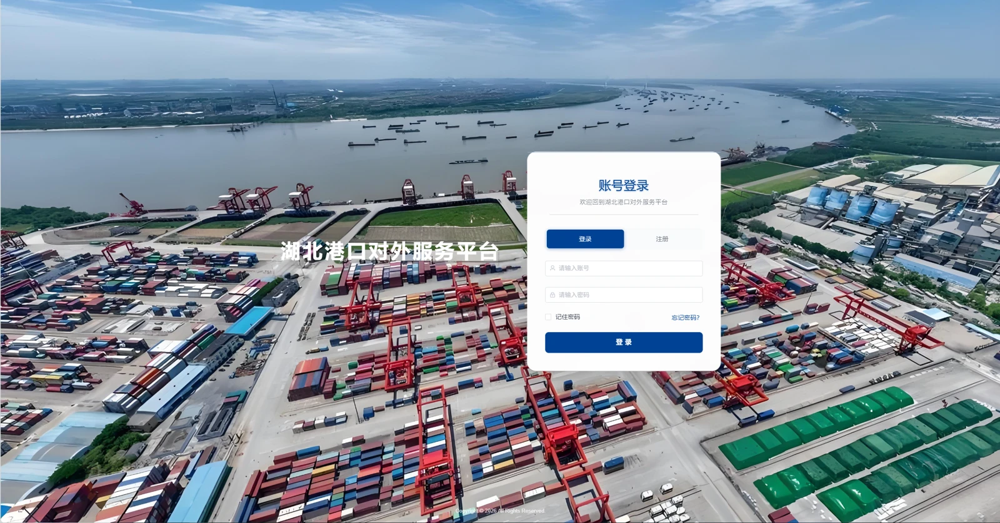

[← Research & projects](/en/research/) · [中文版](/research/port-agent/)

**EDI conversion agent and AI assistant**

LLM/agent workflows for email classification, structured extraction, knowledge mapping, quality checks and EDI conversion, with human review and automated testing.

## Scope and contribution

Participating in the platform, with a focus on the EDI conversion agent and AI assistant. This page describes that work rather than attributing the entire platform to one contributor.

## EDI conversion agent

- Classify business emails and extract key fields from unstructured input.
- Map extracted information to domain knowledge and check data quality.
- Convert structured results into multiple standard EDI message types, with human review and automated testing.

## AI assistant and workflow orchestration

Use LLM/agent workflows and Dify to connect business information processing with tool use, supporting the assistant's multi-step processing of business requests.

## Engineering priorities

Maintain traceable intermediate results and review points between input processing and message generation. Reliability and quality checks are engineering goals; no unverified performance figures or deployment claims are presented.

