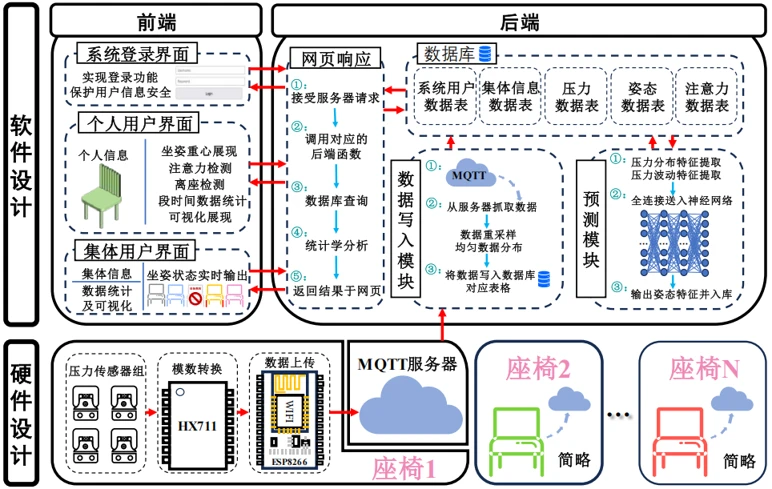

[中文版](/research/)

Research in AIOps, multimodal diagnosis and LLM/agent applications, alongside practical AI engineering. Exploratory work and completed development are identified separately.

## Industry application

<article class="project-card with-image">

Industry application · Contributor
<h3><a href="/en/research/port-agent/">Hubei Port Unified External Service Platform</a></h3>
LLM/agent workflows for email classification, structured extraction, knowledge mapping, quality checks and EDI conversion, with human review and automated testing.
<ul class="tech-tags"><li>LLM</li><li>Agent</li><li>Dify</li><li>EDI</li></ul><a class="project-more" href="/en/research/port-agent/">Project details →</a>
</article>

## Research and infrastructure

<article class="research-note">
Exploratory research
<h3>Multimodal root cause analysis for microservices</h3>
Investigating joint diagnosis using logs, metrics, and traces, with a focus on cross-system generalization and fine-grained root cause localization. Reviewing approaches to multimodal fusion and fault propagation modeling.
</article><article class="research-note">
Exploratory research
<h3>LLM/agent-assisted log analysis</h3>
Studying LLMs and agents for log parsing, anomaly understanding, and root cause reasoning. Exploring multi-step reasoning and tool collaboration, with attention to diagnostic evidence and interpretability.
</article><article class="research-note">
Application-oriented investigation
<h3>Industrial log analysis and intelligent diagnosis</h3>
Investigating log parsing, anomaly detection, and fault localization for industrial metering automation systems, aiming to identify diagnosis approaches suited to real operational needs.
</article><article class="research-note">
Research infrastructure · Engineering development
<h3>Research experimentation and model evaluation</h3>
Building a reproducible experimentation workspace for configuration management, run tracking, metric analysis, and result comparison to support algorithm research and model evaluation.
</article>

## Previous development

<article class="project-card with-image">

Completed development · Core developer
<h3><a href="/en/research/smart-seat/">Smart seat monitoring system</a></h3>
Pressure sensing, MQTT communication, model inference and a web dashboard for posture monitoring and multi-user visualization.
<ul class="tech-tags"><li>ESP8266</li><li>MQTT</li><li>Python</li><li>MySQL</li></ul><a class="project-more" href="/en/research/smart-seat/">Project details →</a>
</article>

### Raspberry Pi-based space mining robot system
Core developer · Mar 2025–Aug 2025
{: .project-meta}

Developed motion control, path planning and obstacle avoidance, and implemented vision algorithms for target detection and environmental perception. Contributed to task allocation and collaboration strategies for a dual-robot platform. The project received a National First Prize at the 27th China Robot and Artificial Intelligence Competition.

### OCR- and AI-based personnel archive retrieval
Project lead · Oct 2024–Jan 2025
{: .project-meta}

Designed a multilingual OCR model combining ResNet, LSTM, and attention. Developed retrieval, structured storage, and access control modules using inverted indexing, fuzzy matching, and MySQL. The project was **recommended at the university level**.

