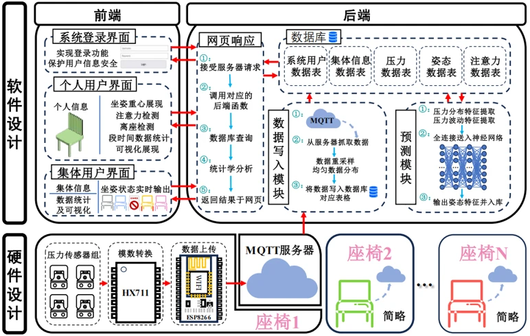

[English version](/en/research/)

围绕 AIOps、多模态诊断与 LLM/Agent 应用开展科研探索，并结合真实业务进行 AI 工程实践。以下分别展示行业应用、在研方向与过往开发。

## 行业应用

<article class="project-card with-image">

行业应用 · 报文转换智能体与 AI 助手
<h3><a href="/research/port-agent/">湖北港口统一对外服务平台</a></h3>
围绕报文转换智能体与 AI 助手，结合 LLM、Agent 与智能工作流，开展邮件分类、字段提取、知识映射、质量校验及 EDI 转换，并结合人工复核与自动化测试。
<ul class="tech-tags"><li>LLM</li><li>Agent</li><li>Dify</li><li>EDI</li></ul><a class="project-more" href="/research/port-agent/">查看项目详情 →</a>
</article>

## 科研探索与实验支撑

<article class="research-note">
科研探索
<h3>多模态微服务根因分析</h3>
围绕日志、指标与调用链开展联合诊断方法调研，探索跨系统泛化与细粒度根因定位，重点梳理多源信息融合与故障传播建模思路。
</article><article class="research-note">
科研探索
<h3>LLM/Agent 辅助日志分析</h3>
研究 LLM/Agent 在日志解析、异常理解与根因推理中的应用，探索多步骤推理和工具协同，关注诊断依据与结果的可解释性。
</article><article class="research-note">
面向实际需求的应用调研
<h3>工业日志分析与智能诊断</h3>
结合工业计量自动化系统需求，开展日志解析、异常检测与故障定位技术调研，探索适用于真实业务环境的智能诊断方案。
</article><article class="research-note">
科研支撑 · 工程建设
<h3>AI 科研实验与模型评测</h3>
建设可复现的科研实验工作台，支持配置管理、运行记录、指标分析与结果对比，为算法实验和模型评测提供工程基础。
</article>

## 过往开发

<article class="project-card with-image">

已完成开发 · 核心开发者
<h3><a href="/research/smart-seat/">智能座椅监测系统</a></h3>
贯通压力采集、MQTT 通信、模型推理与 Web 可视化，实现坐姿监测及多用户数据管理。
<ul class="tech-tags"><li>ESP8266</li><li>MQTT</li><li>Python</li><li>MySQL</li></ul><a class="project-more" href="/research/smart-seat/">查看项目详情 →</a>
</article>

### 基于树莓派的星际采矿机器人系统
核心开发者 · 2025.03–2025.08
{: .project-meta}

负责机器人运动控制模块设计，实现路径规划与避障；开发目标检测与环境感知算法，参与双机器人任务分配及协作策略设计。项目获第二十七届中国机器人及人工智能大赛国家级一等奖。

### 融合 OCR 与 AI 的人事档案高效检索系统
项目负责人 · 2024.10 启动
{: .project-meta}

设计融合 ResNet、LSTM 与 Attention 的多语言 OCR 模型；结合倒排索引、模糊匹配与 MySQL 开发检索、结构化存储及权限控制模块。项目获**校级推优**。

