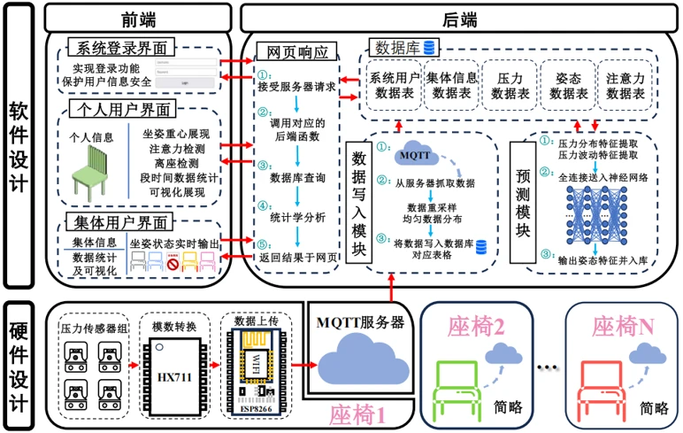

[← Research & projects](/en/research/) · [中文版](/research/smart-seat/)

**Core developer · Mar 2023–Apr 2024**

Pressure sensing, MQTT communication, model inference and a web dashboard for posture monitoring and multi-user visualization.

## Personal contribution

- Led system design and multi-point pressure acquisition using ESP8266 and sensors.
- Developed Python data cleaning, statistics and model inference modules.
- Independently developed the HTML/CSS/JavaScript dashboard for multi-user visualization.

## Technical workflow

Pressure sensors → HX711 / ESP8266 → MQTT → data processing and MySQL → MLP inference and visualization. The supplied architecture connects sensing, storage, prediction and user interfaces.

