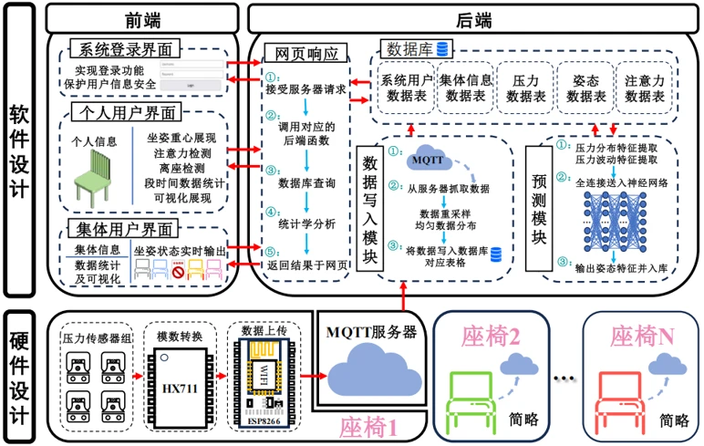

[← 研究与项目](/research/) · [English](/en/research/smart-seat/)

**核心开发者 · 2023.03–2024.04**

贯通压力采集、MQTT 通信、模型推理与 Web 可视化，实现坐姿监测及多用户数据管理。

## 个人贡献

- 主导整体方案设计，基于 ESP8266 与压力传感器建立多点受力数据采集方案。
- 编写 Python 数据清洗、统计与模型推理模块。
- 独立开发 HTML/CSS/JavaScript 可视化面板，支持多用户数据管理与展示。

## 技术流程

压力传感器 → HX711 / ESP8266 → MQTT → 数据处理与 MySQL 存储 → MLP 推理与可视化。架构贯通硬件采集、后端存储、预测模块及个人／集体用户界面。

